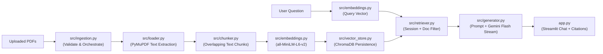

# DocuChat AI — General-Purpose Document RAG Chatbot

DocuChat AI is a modular **Retrieval-Augmented Generation (RAG)** web application built with Python, Streamlit, ChromaDB, Sentence Transformers, and Google Gemini. Upload any PDF documents — resumes, research papers, college notes, SAP documentation, or business reports — and chat with them using grounded answers and exact page citations.

---

## Features

- **Multi-PDF Upload & Management:** Upload multiple PDFs via the Streamlit sidebar, track page and chunk counts, filter which documents to query, and delete documents individually.
- **Page-by-Page Extraction:** Extracts text using PyMuPDF while preserving filename and 1-based page metadata, and warns cleanly on scanned/image-only PDFs.
- **Configurable Chunking & Retrieval:** Tune `Chunk Size`, `Chunk Overlap`, and `Top-K` retrieval count directly from the sidebar settings.
- **Local Free Embeddings:** Generates 384-dimensional dense vectors locally with `all-MiniLM-L6-v2` (lazy-loaded and cached).
- **Persistent Vector Search:** Stores embeddings and metadata locally in ChromaDB with duplicate-ingestion prevention.
- **Streaming Grounded Answers & Citations:** Streams responses live from Google Gemini Flash and attaches expandable source excerpts (`Document Name`, `Page Number`, `Distance Score`).
- **Practical Security Safeguards:** Validates `.pdf` extensions, `%PDF-` file signatures, file size limits (20 MB max), filename sanitization, session-based isolation, and prompt-injection defense rules.

---

## Architecture Overview



---

## Project Structure

```text
DocChatAI/
├── app.py                  # Streamlit chat UI & sidebar controls
├── requirements.txt        # Python dependencies
├── .env                    # Local environment variables (not committed)
├── .gitignore              # Protects secrets, vector store & caches
├── README.md               # Project documentation
├── documents/              # Optional sample PDFs folder
├── src/
│   ├── loader.py           # PDF text extraction (PyMuPDF)
│   ├── chunker.py          # Configurable sliding-window text chunker
│   ├── embeddings.py       # Lazy-loaded SentenceTransformer embeddings
│   ├── vector_store.py     # ChromaDB PersistentClient, filter & delete
│   ├── ingestion.py        # Validation & end-to-end document ingestion
│   ├── retriever.py        # Top-K semantic search with metadata filters
│   └── generator.py        # Grounded prompt builder & Gemini streaming
└── tests/
    ├── conftest.py
    ├── test_loader.py
    ├── test_chunker.py
    ├── test_embeddings.py
    ├── test_vector_store.py
    ├── test_retriever.py
    ├── test_ingestion.py
    └── test_generator.py
```

---

## Quick Start (Windows PowerShell)

### 1. Create and activate a virtual environment
```powershell
python -m venv .venv
.\.venv\Scripts\Activate.ps1
```

### 2. Install dependencies
```powershell
pip install -r requirements.txt
```

### 3. Configure your Gemini API key
Create or update `.env` in the project root:
```env
GEMINI_API_KEY=your_actual_gemini_api_key_here
```
*(You can generate a free API key at [Google AI Studio](https://aistudio.google.com/).)*

### 4. Run the Streamlit app
```powershell
streamlit run app.py
```
Open `http://localhost:8501` in your browser, upload one or more PDFs in the sidebar, click **Upload & Index PDFs**, and start chatting!

---

## Running Tests

Run the full automated unit test suite with `pytest`:
```powershell
pytest -v
```

Run fast tests for a specific module:
```powershell
pytest tests/test_ingestion.py -v
```

---

## Security & Known Limitations

DocuChat AI treats uploaded PDFs as **untrusted data** and implements practical safeguards suitable for a local/single-instance application:
- **Upload Validation:** Enforces `.pdf` extensions, `%PDF-` header byte checks, a 20 MB file size cap, and `Path(name).name` path-traversal sanitization.
- **Prompt Injection Defense:** Wraps retrieved excerpts in clear delimiters and instructs Gemini to ignore instructions embedded inside document text.
- **Privacy & Secret Hygiene:** `.env` is excluded via `.gitignore`, and document text is not logged to console output.
- **Session-Based Isolation Scope:** Documents are tagged with a per-browser-session `session_id` and filtered on retrieval/deletion. **Limitation:** Because this local beginner version has no login system, session-based isolation separates browser sessions locally rather than providing cryptographic multi-tenant security. A production deployment would require authenticated user accounts, server-side authorization checks, and isolated tenant storage.

